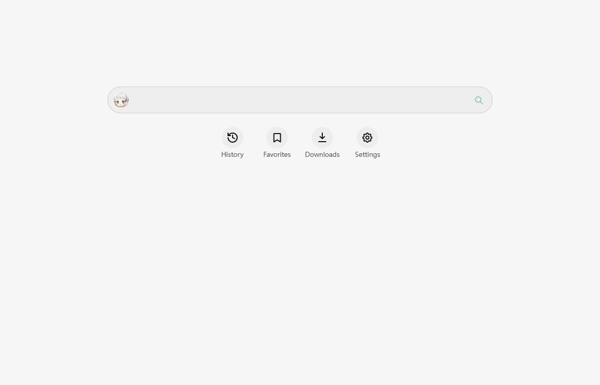
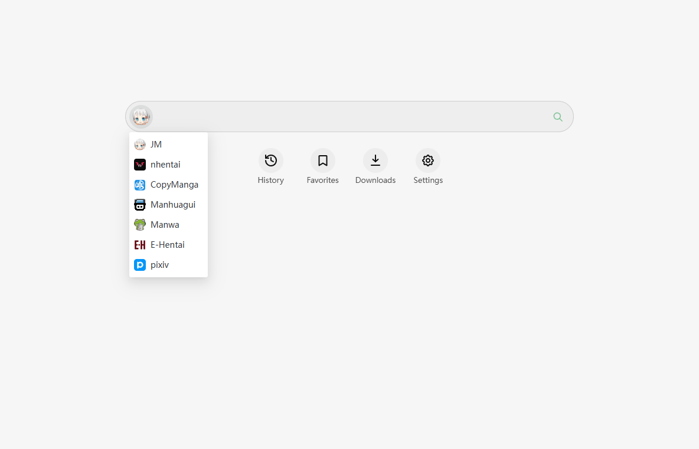
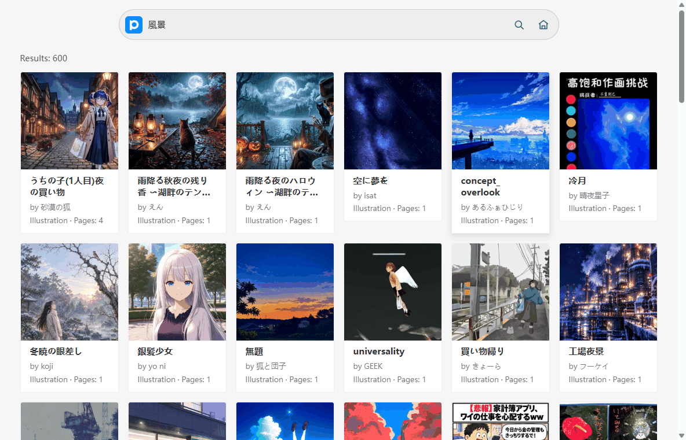
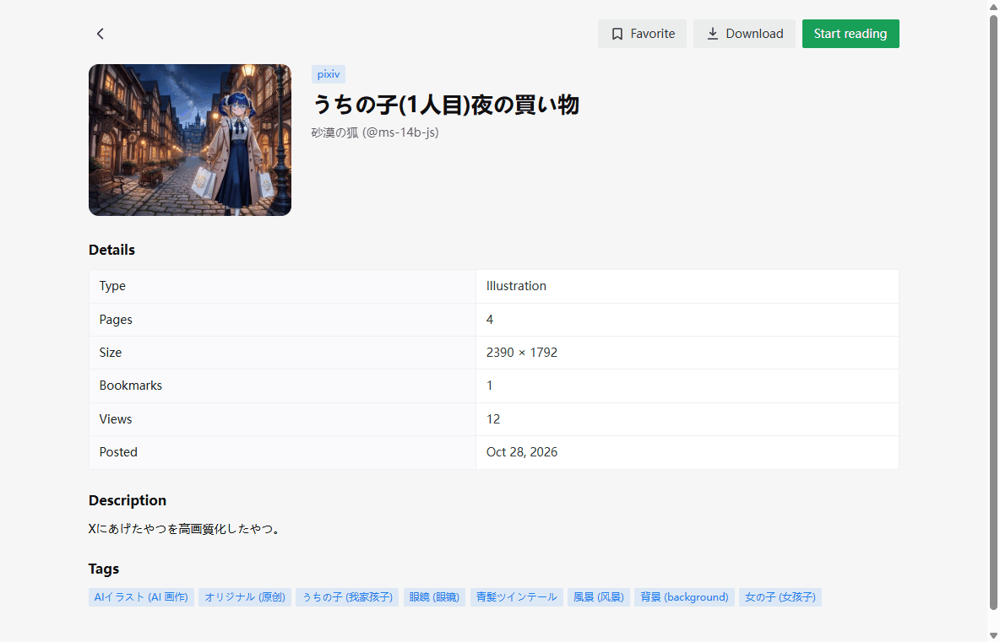
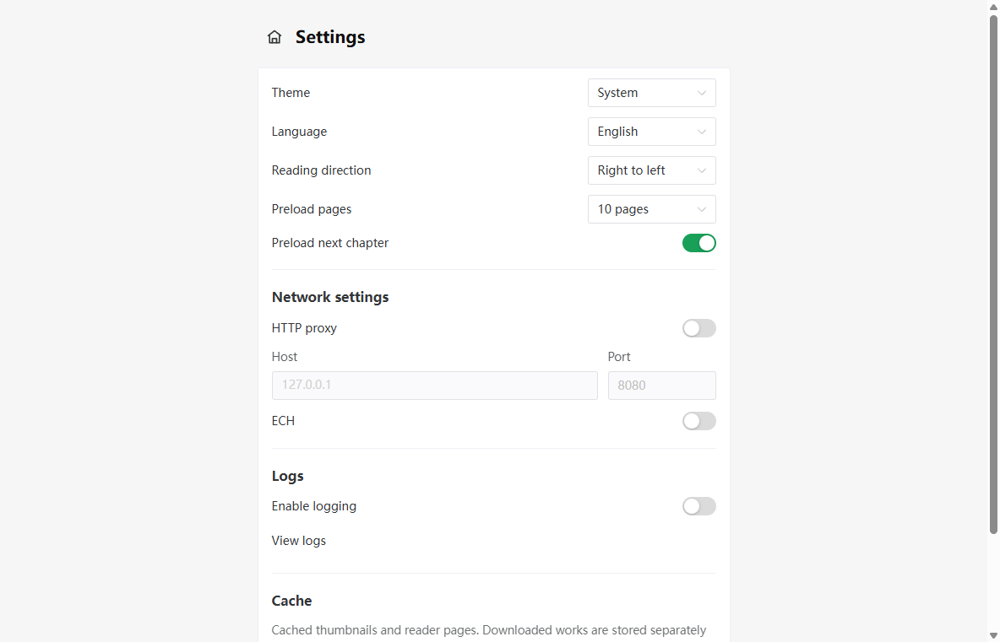
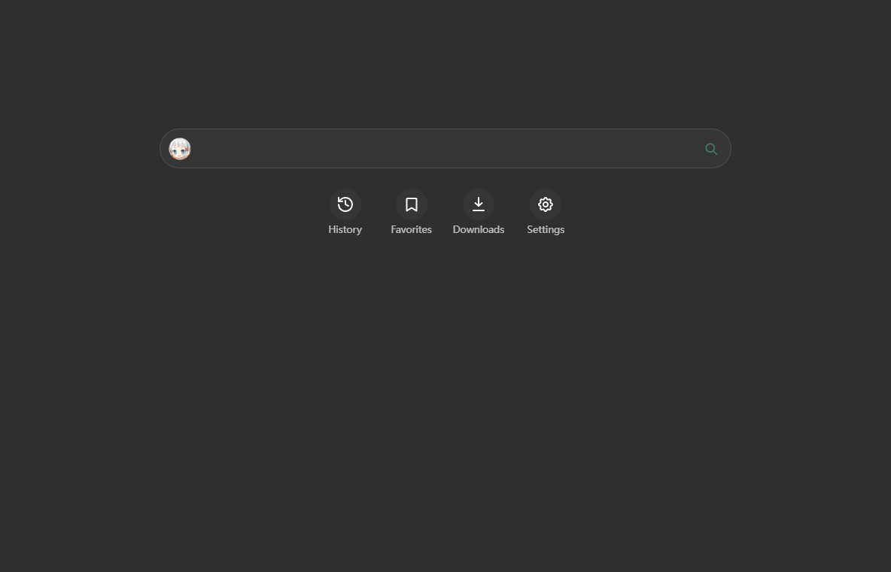

<div align="center">

# Comics Reader

**A cross-platform comic reader for Tauri 2 — search, read, favorite and download from seven sources.**

[English](README.md) · [简体中文](README.zh-CN.md)

[](LICENSE)
[](https://tauri.app)
[](https://vuejs.org)
[](https://www.rust-lang.org)

</div>

---

## Screenshots

<p align="center">
  
  
  
  
  
  
</p>

<sub>Captured from a real build at 1200×800. See [`docs/images/README.md`](docs/images/README.md)
for capture notes.</sub>

## Features

- **Seven comic sources** — search, details and reading on one unified interface.
- **Reader built for long sessions** — three-page track with gapless sliding, LTR/RTL/vertical reading, pinch or scroll zoom, panning, keyboard shortcuts, and automatic chapter rollover at the first and last page.
- **Reading history** — per title and chapter, resumes exactly where you left off.
- **Favorites with groups** — organize saved titles into custom groups, with a dedicated group bar.
- **Downloads and offline reading** — download a whole title, then read it without a network connection.
- **Built-in network tools** — an HTTP proxy setting and Encrypted Client Hello (ECH) support, for networks where direct access is blocked.
- **Log viewer** — inspect and export the application log without leaving the app.
- **Image cache management** — see how much space the cache uses and clear it from Settings.
- **Light and dark themes**, English and Simplified Chinese interface, desktop and Android layouts.

## Supported platforms

| Platform | Search | Details | Reading | Notes |
| --- | :---: | :---: | :---: | --- |
| [JM](https://18comic.vip/) | ✅ | ✅ | ✅ | Uses the mobile app API; page images are scrambled and decoded on the fly. |
| [nhentai](https://nhentai.net/) | ✅ | ✅ | ✅ | Single-chapter works. |
| [拷贝漫画 / Copy Manga](https://www.mangacopy.com/) | ✅ | ✅ | ✅ | Chapter list is grouped by site section; page images are AES-encrypted. |
| [manhuagui](https://www.manhuagui.com/) | ✅ | ✅ | ✅ | Chapter list is grouped by update batch. |
| [漫蛙 / Manwa](https://manwa.me/) | ✅ | ✅ | ✅ | Anonymous content only; uses several interchangeable image CDNs. |
| [E-Hentai](https://e-hentai.org/) | ✅ | ✅ | ✅ | Anonymous galleries only; no ExHentai, no logins, no original-resolution files. |
| [pixiv](https://www.pixiv.net/) | ✅ | ✅ | ✅ | Public works only. R-18 and login-restricted works are not available anonymously. |

### Good to know before you start

- **No accounts are used.** The app never asks for a login and never stores cookies. Every platform is used anonymously, which means content that requires an account is simply not reachable.
- **Some sources need a proxy.** Depending on your network, JM, E-Hentai, pixiv and Manwa may not respond to direct requests. Configure an HTTP proxy or enable ECH in Settings if a platform fails to load.
- **The app hosts no content.** It links to third-party sites and renders what they return. See [Legal & disclaimer](#legal--disclaimer).

## Getting started

### Requirements

| Tool | Version |
| --- | --- |
| [Node.js](https://nodejs.org/) | `^22.12.0` \|\| `^24.0.0` \|\| `>=26.0.0` |
| [pnpm](https://pnpm.io/) | latest |
| [Rust](https://www.rust-lang.org/tools/install) | stable, 1.85 or newer |
| [Tauri prerequisites](https://tauri.app/start/prerequisites/) | WebView2 on Windows, Xcode on macOS, `webkit2gtk` on Linux |
| Android SDK / NDK / JDK | only if you want to build for Android |

### Run it from source

```bash
git clone https://github.com/MeiK2333/comics-reader.git
cd comics-reader
pnpm install

pnpm tauri dev
```

`pnpm tauri dev` starts the full application with hot reload for the frontend.

> `pnpm dev` and `pnpm preview` serve **only the frontend** on port 1420. The
> Tauri APIs (search, images, downloads, storage) are unavailable there, so
> use `pnpm tauri dev` whenever you need the real app.

### Build from source

```bash
pnpm tauri build
```

> The bundle step is disabled by default (`bundle.active` is `false` in
> `src-tauri/tauri.conf.json`), so this command produces binaries without
> generating installers. Enable bundling explicitly in that file when you
> need a distributable package.

## Downloads

Pre-built packages are published on the
[GitHub Releases page](https://github.com/MeiK2333/comics-reader/releases):

| Platform | Artifact |
| --- | --- |
| Windows | `comics-reader_<version>_x64-setup.exe`, `comics-reader_<version>_x64_en-US.msi`, `comics-reader_<version>_x64.exe` |
| Android | `comics-reader_<version>_<abi>.apk` (`arm64-v8a`, `armeabi-v7a`, `x86_64`, `x86`) |

Check the release notes for the exact version and any platform-specific notes.
Your system must be able to run Tauri 2 — on Windows that means the
[WebView2 runtime](https://developer.microsoft.com/microsoft-edge/webview2/) is
installed.

## Architecture

```
┌──────────────────────────────────────────┐
│  Frontend — Vue 3 + TypeScript + Vite    │
│  views / components / composables / api  │
└──────────────┬───────────────────────────┘
               │  Tauri IPC (invoke)
               │  commands return Result<T, AppError>
┌──────────────▼───────────────────────────┐
│  Backend — Rust (Tauri 2)                │
│  platforms/ · image/ · ech/ · downloads/ │
│  history.rs · favorites.rs · storage.rs  │
└──────────────┬───────────────────────────┘
               │  HTTPS (reqwest + rustls)
┌──────────────▼───────────────────────────┐
│  Upstream comic sites                    │
└──────────────────────────────────────────┘
```

Two rules shape the codebase:

- **The frontend never talks to the network.** Every HTTP request, every page
  image and every cache lookup goes through a Rust command. The frontend only
  calls `invoke` and renders the result.
- **Platform-specific code is isolated.** A platform owns one directory on each
  side, and a shared image pipeline talks to it through a small trait surface
  (`ImageProfile`, `Catalog`). The shared code never learns a platform name.

## Project layout

```
comics-reader/
├── src/                    # Frontend (Vue 3 + TypeScript)
│   ├── api/                # Typed wrappers around every IPC command
│   ├── components/         # Shared UI, including the reader overlay
│   ├── composables/        # Reusable behaviour (zoom, gestures, preload…)
│   ├── platforms/<id>/     # Per-platform frontend: card, detail, types, copy
│   ├── i18n/messages/      # en.json (master) and zh-CN.json
│   ├── router/             # Routes and the navigation stack
│   ├── stores/             # Pinia stores (settings, search, runtime)
│   └── views/              # One component per screen
├── src-tauri/
│   ├── src/
│   │   ├── platforms/      # Per-platform Rust implementation + fixtures
│   │   ├── image/          # Fetching, cache keys, cache eviction
│   │   ├── ech/            # Encrypted Client Hello bootstrap and TLS
│   │   ├── downloads/      # Download queue, worker and on-disk layout
│   │   ├── history.rs      # Reading history (JSONL)
│   │   ├── favorites.rs    # Favorites and groups
│   │   └── storage.rs      # Paths and persistence helpers
│   └── capabilities/       # Tauri permissions for the main window
├── contracts/              # Pinned JSON shapes for cross-layer payloads
├── e2e/                    # WebDriver end-to-end suite
├── docs/images/            # Screenshots used by this README
├── AGENTS.md               # Full engineering contract for contributors
└── ROADMAP.md              # Planned sources and features
```

## Development

Frontend commands run from the repository root; Rust commands run from
`src-tauri/`.

| Command | What it does |
| --- | --- |
| `pnpm dev` | Frontend only, on port 1420. No Tauri APIs. |
| `pnpm tauri dev` | The full application with hot reload. **Use this one.** |
| `pnpm build` | Type-check with `vue-tsc` and build the frontend. Does not compile Rust. |
| `pnpm test` | Run the Vitest suite once (jsdom). |
| `pnpm test:watch` | Vitest in watch mode. |
| `pnpm test:e2e` | Build a debug bundle and run the WebDriver suite in `e2e/`. Windows only; needs `tauri-driver` and a matching Edge WebDriver. |
| `pnpm tauri build` | Build the application for the current platform. |
| `cargo test` | Run the Rust test suite. |
| `cargo fmt --check` | Check Rust formatting. |
| `cargo clippy --all-targets -- -D warnings` | Lint Rust with warnings denied. |

There is no CI, so these local checks are the gate: run `pnpm test` and
`pnpm build` for frontend changes, and `cargo test`, `cargo fmt --check` and
`cargo clippy --all-targets -- -D warnings` for Rust changes.

### Adding a platform

A platform is added in two places — a frontend directory and a Rust module —
plus one registration entry on each side:

1. `src-tauri/src/platforms/<id>.rs` — implement `ImageProfile` (required) and
   `Catalog` (search / details / reading).
2. `src-tauri/src/platforms/registry.rs` — register it.
3. `src/platforms/<id>/` — `index.ts`, `types.ts`, `messages.ts`, `ResultCard.vue`,
   `Detail.vue`, an icon and `fixtures/wire.json`.
4. `src/platforms/index.ts` — add it to `platformList`.

Detailed guides live in
[`src/platforms/README.md`](src/platforms/README.md) (frontend) and
[`src-tauri/src/platforms/README.md`](src-tauri/src/platforms/README.md)
(backend).

## Contributing

Contributions are welcome. Please read
[`AGENTS.md`](AGENTS.md) first — it documents the cross-layer contracts,
the error-code and i18n rules, and the constraints that are easy to break.

A few house rules:

- Use [Conventional Commits](https://www.conventionalcommits.org/) with an
  imperative, lowercase subject, and keep one logical change per commit.
- The default branch is `master`.
- Do not commit build output, generated files or unrelated changes.

## Roadmap

Planned sources: [包子漫画](https://www.baozimh.com/),
[manhuabika](https://manhuabika.com/) and
[热辣漫画 / Manga2026](https://www.manga2026.com/).

Planned features: a comic library, a standalone chapter-list screen,
per-chapter selection and CBZ/folder export, and a persistent database
instead of the current flat files.

See [`ROADMAP.md`](ROADMAP.md) for the current list.

## Legal & disclaimer

Comics Reader is a client. It does not host, mirror or store comic content —
it requests pages from third-party sites and displays what those sites return
in your own browser window. Images that you download are cached or saved on
your own device for offline reading.

- You are responsible for complying with the terms of service of the sites you
  access and with the copyright law that applies in your jurisdiction.
- The app provides no accounts and cannot reach paid or login-restricted
  content. Do not attempt to circumvent those restrictions with it.
- The project is not affiliated with, endorsed by, or sponsored by any of the
  supported comic sites. Platform names and icons belong to their respective
  owners and are used only to identify the source.
- The software is provided "as is", without warranty of any kind. The
  maintainers are not liable for any damage arising from its use.

## License

Released under the [MIT License](LICENSE). Copyright © 2026 MeiK2333.
